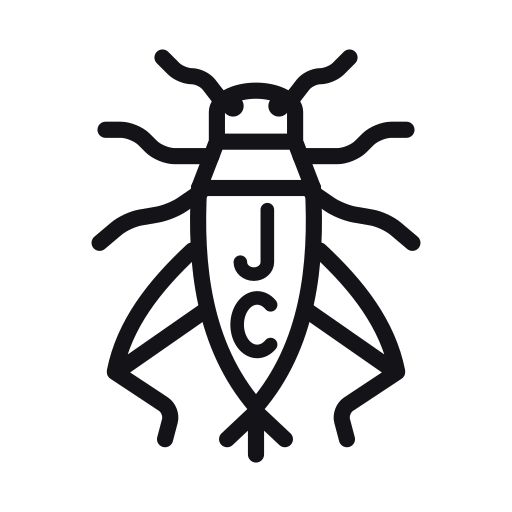

  

<h1 align="center">Giovanni Grillo</h1>

  CS graduate · MSc student in Artificial Intelligence 
  Machine Learning, Deep Learning and solid, practical projects.

---

### Projects

**[pocket-wifi-monitor](https://github.com/GiovanniGrillo/pocket-wifi-monitor)**
A spare Android phone with a SIM becomes a remote mobile-network quality sensor, with a local web dashboard.
Python · vanilla JS · Termux · Tailscale

### Stack

**Languages** — Python · Java · JavaScript · C · SQL  
**ML / AI** — PyTorch · TensorFlow · scikit-learn  
**Web** — React · Vite · Node.js  
**Tools** — Git · Docker · Linux · VS Code · GitHub Actions  
**Mobile & network** — Termux · Tailscale · ADB · Bash

 

  

